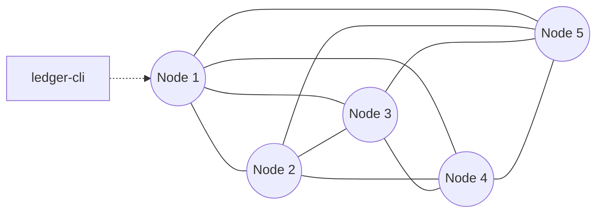
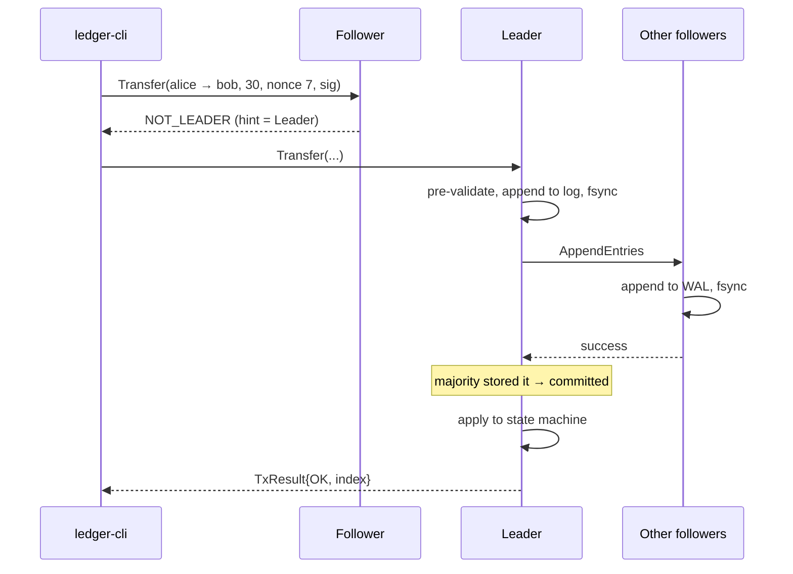

# QuorumPay

**A crash-fault-tolerant peer-to-peer payment ledger, replicated across 5 nodes with Raft consensus written from scratch.**


Clients create accounts and send **Ed25519-signed transfers** to any node. The cluster agrees on a single
order of transactions with **Raft**. Every node applies that order to a **deterministic state machine**,
so all replicas hold identical balances. The ledger keeps working as long as a majority (3 of 5) of
nodes is up. It survives crashes, restarts and network partitions without losing an acknowledged
payment or applying one twice.

---

## Table of Contents

- [Features](#features)
- [Architecture](#architecture)
- [How a Payment Flows](#how-a-payment-flows)
- [Design Decisions](#design-decisions)
- [Transactions & Validation](#transactions--validation)
- [Persistence & Recovery](#persistence--recovery)
- [Getting Started](#getting-started)
- [Usage](#usage)
- [Fault Injection & Demos](#fault-injection--demos)
- [Testing](#testing)
- [Benchmarks](#benchmarks)
- [Project Structure](#project-structure)
- [Roadmap](#roadmap)
- [Scope & Limitations](#scope--limitations)

---

## Features

| Area | What it does |
|---|---|
| **Consensus** | Raft leader election, log replication, commit rules, **pre-vote**, a no-op entry on election, all written from scratch |
| **Consistency** | Linearizable writes; **linearizable reads via ReadIndex**; exactly-once submission via nonce + `tx_id` |
| **Security** | Ed25519-signed transactions, per-account nonces (stop replays), `chain_id` + domain-separated signing bytes |
| **Durability** | Write-ahead log with CRC32, **group-commit fsync**, crash-safe atomic metadata writes |
| **Compaction** | Snapshots, log compaction, and chunked `InstallSnapshot` for followers that fall far behind |
| **Networking** | Single-threaded **epoll** event loop, non-blocking sockets, length-prefixed **protobuf** framing, reconnect with backoff + jitter |
| **Fault injection** | Kill / restart / partition / heal any node at runtime from a Python harness |
| **Verification** | Deterministic Raft simulator, Jepsen-style history checker, chaos testing, cross-node balance-hash comparison |
| **Tooling** | `ledger-cli` (wallet + client), `ledger-admin`, cluster manager, benchmark and plotting scripts |

---

## Architecture

```
                 ┌──────────────────────── Node process ───────────────────────────┐
  ledger-cli ───▶│  Client port ──▶ ClientService ──┐                               │
  (signs txs)    │                                  ▼                               │
                 │  Peer port  ◀──▶ PeerManager ◀──▶ RaftCore (pure logic, no I/O)  │
  harness ──────▶│  (admin cmds)    + FaultFilter       │  Ready{persist, send,    │
  (kill/part.)   │                                      │        apply, snapshot}  │
                 │                                      ▼                           │
                 │                 Storage (MetaStore, WAL, SnapshotStore)          │
                 │                                      │ committed entries         │
                 │                                      ▼                           │
                 │                 StateMachine (accounts, nonces, history)         │
                 │                                                                  │
                 │  Everything runs on ONE event-loop thread (epoll + timerfd)      │
                 └──────────────────────────────────────────────────────────────────┘
```

The five nodes form a **full mesh**. Each pair of nodes uses two TCP connections, one dialed in each direction.



**Module layering** (enforced by CMake: a module can only include headers from the libraries it links):

```
common ◀── crypto ◀── ledger
common ◀── raft                 (raft never sees net/ or storage/)
common ◀── net
crypto ◀── storage
all    ◀── server (ledger-node)
```

---

## How a Payment Flows



1. The client signs the transfer locally. The private key never leaves the client.
2. A follower that receives the request redirects the client to the leader.
3. The leader appends the transaction to its log and replicates it with `AppendEntries`.
4. Once a **majority** has stored the entry durably, it is **committed**.
5. Every node applies committed entries **in log order**. The leader replies to the client with the result.

---

## Design Decisions

1. **`RaftCore` is pure logic with no I/O** (in the style of etcd/raft). It takes inputs (`step(msg)`, `tick()`,
   `propose()`, `read_index()`) and returns a `Ready` batch that says what to persist, what to send, and what
   to apply. The node does the actual I/O. This means Raft can be tested **deterministically** in a
   simulated network with a virtual clock and seeded randomness.
2. **One event-loop thread per node.** Networking, Raft and apply all run on one thread, so there are no
   locks and no data races inside the consensus code. The trade-off is a lower throughput ceiling in exchange for
   code that is much easier to reason about.
3. **Deterministic state machine.** There is no wall-clock time, randomness or hash-map iteration order in the apply
   path. Accounts live in a `std::map` and are serialized in sorted order. The same log therefore produces
   the same state hash on every node.
4. **A newly elected leader appends a no-op entry.** This lets it commit entries from earlier terms (Raft §5.4.2), and ReadIndex
   needs it.
5. **No transport-level retries.** Raft already tolerates lost messages, so the network layer simply drops
   messages it can't deliver.
6. **Sign canonical bytes, not protobuf bytes.** Protobuf serialization isn't guaranteed to be canonical, so
   signatures cover a fixed, hand-written encoding with a domain-separation prefix.

---

## Transactions & Validation

Two transaction types: `CREATE_ACCOUNT` (signed by the new key itself, as proof that the creator holds it) and `TRANSFER`.

Every node runs this pipeline on every committed entry, in log order:

| Step | Check | Failure status | Nonce consumed? |
|---|---|---|---|
| 1 | Well-formed (name rules, amount > 0, sender ≠ receiver, chain_id) | `MALFORMED` | No |
| 2 | Sender exists / name is free | `UNKNOWN_ACCOUNT` / `DUPLICATE_ACCOUNT` | No |
| 3 | Signature is valid | `BAD_SIGNATURE` | No |
| 4 | `nonce == next_nonce` | `BAD_NONCE` | No |
| 5 | Receiver exists | `UNKNOWN_RECEIVER` | Yes |
| 6 | Enough balance, no overflow | `INSUFFICIENT_FUNDS` / `OVERFLOW` | Yes |
| 7 | Debit, credit, `next_nonce++` | `OK` | Yes |

A nonce is consumed only after the transaction is **proven to come from the sender**. This means nobody can burn
another account's nonces by sending unsigned or badly signed transactions. Total supply stays constant: money enters only through
transfers from the genesis faucet account.

---

## Persistence & Recovery

```
data/node-N/
├── meta                       # currentTerm + votedFor (atomic: tmp → fsync → rename → fsync dir)
├── wal/000001.log ...         # [len][crc32][type][term][index][payload]
└── snap/snap-<term>-<index>.snap
```

- **Torn writes:** on startup the WAL is scanned and cut at the first record with a bad length or CRC.
- **Group commit:** all records produced in one event-loop iteration are fsynced **once**, before any acknowledgment is sent.
- **Recovery:** load `meta`, then the newest valid snapshot, then replay the WAL into the Raft log. The node rejoins as a
  follower and learns `commitIndex` from the leader.
- **Snapshots** are taken every 1000 applied entries. Old WAL segments are then deleted. A follower that
  falls behind the compacted log receives the snapshot in 1 MB `InstallSnapshot` chunks.

---

## Getting Started

### Prerequisites

Linux, a C++17 compiler, CMake ≥ 3.16, protobuf, libsodium and Python 3.

```sh
sudo apt install -y build-essential cmake protobuf-compiler libprotobuf-dev libsodium-dev python3
```

GoogleTest and nlohmann/json are downloaded automatically by CMake.

### Build & test

```sh
cmake -S . -B build
cmake --build build -j
ctest --test-dir build --output-on-failure
```

Sanitizer build (AddressSanitizer + UndefinedBehaviorSanitizer):

```sh
cmake -S . -B build-asan -DLEDGER_SANITIZE=ON -DCMAKE_BUILD_TYPE=Debug
cmake --build build-asan -j && ctest --test-dir build-asan
```

The build produces:

| Binary | Purpose |
|---|---|
| `ledger-node` | One cluster node |
| `ledger-cli` | Wallet and client: keys, accounts, transfers, balances |
| `ledger-admin` | Admin commands: status, block/unblock peers |

---

## Usage

### Run a local 5-node cluster

```sh
tools/cluster.py start              # start all 5 nodes (logs: data/node-N/node.log)
tools/cluster.py status             # role, term, leader, commit index, state hash per node
tools/cluster.py stop
```

### Send payments

```sh
ledger-cli keygen faucet && tools/make_genesis.py    # one-time genesis setup

ledger-cli create_account alice
ledger-cli create_account bob
ledger-cli fund alice 100
ledger-cli transfer alice bob 30
ledger-cli balance bob                              # linearizable read (ReadIndex)
ledger-cli history alice --limit 10
ledger-cli tx <tx_id>
ledger-cli status --all
```

Global flags: `--config config/cluster.json`, `--node N`, `--timeout ms`.

---

## Fault Injection & Demos

```sh
tools/cluster.py kill 3                 # SIGKILL: simulates a crash
tools/cluster.py restart 3              # recovers from WAL + snapshot
tools/cluster.py partition 1,2 3,4,5    # split the network
tools/cluster.py heal
```

| Demo | What it shows |
|---|---|
| **Double spend** (`tools/demos/demo_double_spend.py`) | Two conflicting transfers with the same nonce are sent to different nodes at the same moment, and exactly one commits. Replayed and tampered transactions are rejected. All 5 nodes end with identical state hashes. |
| **Leader failure** (`tools/demos/demo_leader_failure.py`) | The leader is killed while transfers are running. A new leader is elected, clients retry, and no acknowledged transaction is lost or applied twice. The old leader recovers and catches up. |
| **Network partition** (`tools/demos/demo_partition.py`) | The leader ends up on the minority side and can't commit. The majority elects a new leader and keeps going. Pre-vote stops terms from inflating. After healing, all nodes converge. |

---

## Testing

| Layer | Location | What it covers |
|---|---|---|
| Unit | `tests/unit/` | Framing, connections, peer manager, config, crypto, state machine, WAL |
| Simulation | `tests/sim/` | Deterministic Raft runs with seeded drops, delays and partitions. Checks election safety, log matching and leader completeness |
| Integration | `tests/integration/` | Real 5-process clusters on localhost |
| Consistency | `tools/workload.py` + `tools/checker.py` | Jepsen-style: records a concurrent operation history and checks linearizability and that money is conserved |
| Chaos | `tools/chaos.py` | Random kills and partitions under load for N minutes |

```sh
ctest --test-dir build                       # unit + simulation tests
python3 tests/integration/test_network.py    # end-to-end on real processes
```

---

## Benchmarks

| # | Experiment | Measures |
|---|---|---|
| B1 | Commit latency vs. load (1–64 clients) | p50 / p95 / p99 latency, throughput |
| B2 | Batching (`max_entries_per_append`) | Throughput, p99 |
| B3 | fsync policy: per-entry vs. group commit vs. none | The cost of durability |
| B4 | Recovery time: full replay vs. snapshot | Time from restart to caught up |
| B5 | Failover (50 leader kills) | Kill → new leader → first commit (CDF) |

```sh
python3 tools/bench.py && python3 tools/plot.py     # results → results/, graphs → docs/img/
```

Methodology and results: [`docs/benchmarks.md`](docs/benchmarks.md). All nodes run on one machine, so the
results are meant for **relative** comparisons.

---

## Project Structure

```
QuorumPay/
├── proto/             # protobuf messages: peer, raft, ledger, client, envelope
├── config/            # cluster.json (5 nodes), genesis.json (faucet)
├── src/
│   ├── common/        # types, config loading, structured logger
│   ├── crypto/        # Ed25519 keys/sign/verify, SHA-256, CRC32
│   ├── ledger/        # transactions, accounts, state machine, state hash
│   ├── raft/          # RaftCore, log, progress tracking, ReadIndex (no I/O)
│   ├── storage/       # MetaStore, WAL, snapshots, fsync helpers
│   ├── net/           # epoll loop, framing, connections, peer mesh, fault filter
│   ├── server/        # ledger-node: wires everything together
│   └── client/        # ledger-cli and ledger-admin
├── tests/             # unit/, sim/, integration/
├── tools/             # cluster manager, faults, workload, checker, chaos, bench, demos
└── docs/              # design, Raft notes, protocol formats, benchmarks
```

Full design specification: [`project_details.md`](project_details.md).


## Scope & Limitations

Not included, by design:

- **Byzantine fault tolerance.** Nodes trust each other; signatures protect against forged *client* transactions only.
- **Cluster membership changes.** The 5-node configuration is fixed.
- **TLS between nodes, multi-machine deployment, sharding.**

---

## References

- Diego Ongaro and John Ousterhout, [*In Search of an Understandable Consensus Algorithm (Raft)*](https://raft.github.io/raft.pdf)
- Diego Ongaro, *Consensus: Bridging Theory and Practice* (PhD thesis): pre-vote, ReadIndex
- [etcd/raft](https://github.com/etcd-io/raft): the "pure core + Ready" design
- [Jepsen](https://jepsen.io/): history-based consistency checking
