# QuorumPay: Progress

_Last updated: 2026-10-29_

This file shows **what is built, what is left, and how the working parts fit together today**.
The full design is in [`project_details.md`](project_details.md).

---

## 1. Overall progress

Counted against the **49 "Build" items** in the plan (§8 of `project_details.md`):

```
Overall   [█████████████░░░░░░░░░░░░░░░░░]  ~45%   (≈22 of 49 build items)
```

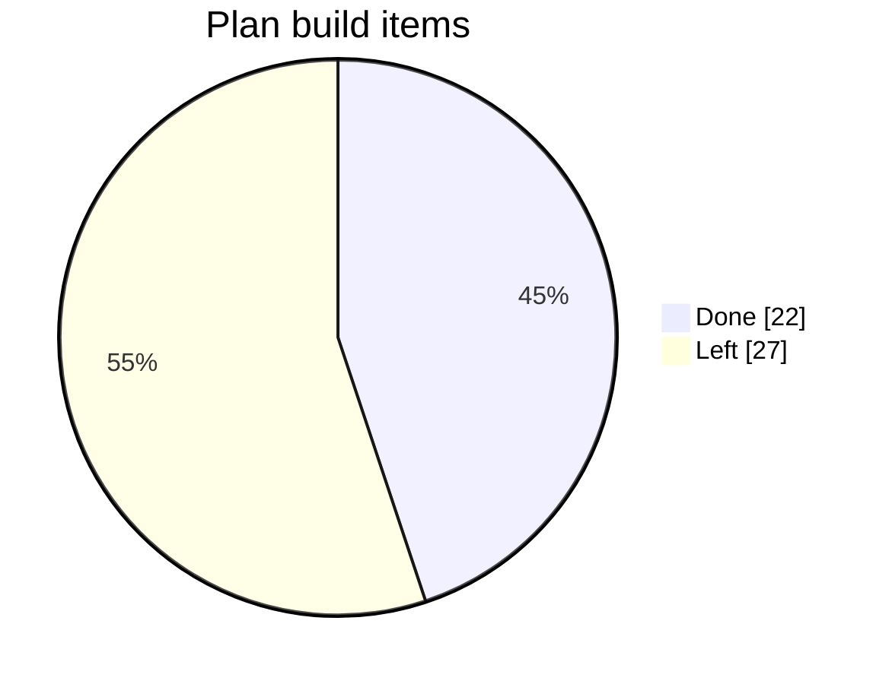

> By *effort* it's closer to **38%**: the Raft core (Weeks 2–3, the hardest part) is done, but Weeks 5 and 6 haven't started.

### By plan week

| Week | Topic | Progress | Status |
|---|---|---|---|
| 1 | Foundations: crypto, transactions, state machine | `██░░░░░░░░` 2 / 7 | 🟨 skeleton + framing only |
| 2 | Raft: leader election + simulator | `██████████` 6 / 6 | ✅ done |
| 3 | Raft: replication, commit, apply, ReadIndex | `█████████░` 6 / 7 | ✅ Raft core done · RETRY tracking moved to step 6 |
| 4 | Network + node + CLI | `████████░░` 7 / 9 | 🟨 network + node (persist → send → apply) done; client service + CLI left |
| 5 | Persistence: WAL, snapshots, recovery | `░░░░░░░░░░` 0 / 7 | ⬜ |
| 6 | Pre-vote, checker, demos, chaos | `░░░░░░░░░░` 0 / 6 | ⬜ |
| 7 | Benchmarks + docs | `█░░░░░░░░░` 0.5 / 7 | 🟨 README only |

---

## 2. Build order (bottom-up)

We build one layer at a time. Each step adds one idea and ends with something you can run.

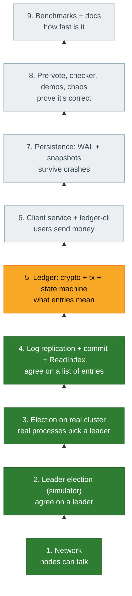

| Step | Plan week | Status |
|---|---|---|
| 1. Network | Week 4 (items 1–4) | ✅ |
| 2. Election in simulator | Week 2 | ✅ |
| 3. Election on real cluster | Week 4 (item 5, partly) | ✅ |
| 4. Log replication + commit + ReadIndex | Week 3 | ✅ |
| 5. Ledger (needs `libsodium-dev`) | Week 1 | 🔜 **next** |
| 6. Client service + CLI | Week 4 (items 6, 8) | ⬜ |
| 7. Persistence | Week 5 | ⬜ |
| 8. Correctness under faults | Week 6 | ⬜ |
| 9. Benchmarks + docs | Week 7 | ⬜ |

---

## 3. Module status

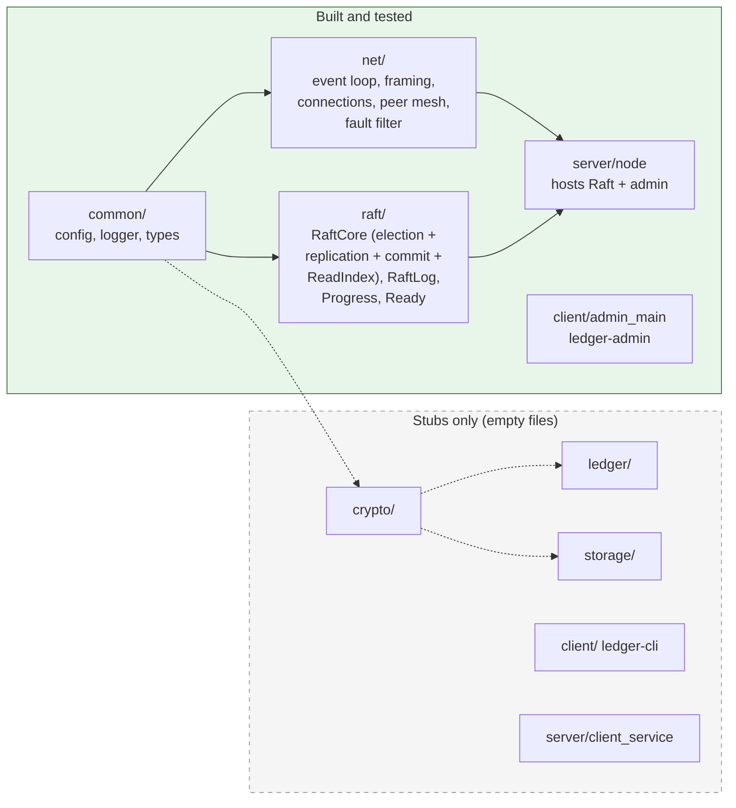

| Module | Files | State |
|---|---|---|
| `common/` | `types.h`, `config`, `logger`, `clock.h` | ✅ (`status.h` is a stub) |
| `net/` | `event_loop`, `framing`, `connection`, `listener`, `peer_manager`, `fault_filter` | ✅ |
| `raft/` | `raft_core`, `raft_log`, `progress.h`, `read_index`, `ready.h` | ✅ election + replication + commit + ReadIndex |
| `server/` | `node`, `main` | ✅ runs Raft, applies entries (running hash), `propose` test command · `client_service`, `admin_service` are stubs |
| `client/` | `admin_main` (`ledger-admin`) | ✅ · `client_lib`, `keystore`, `ledger-cli` are stubs |
| `crypto/`, `ledger/`, `storage/` | — | ⬜ stubs |
| `proto/` | `peer`, `client`, `envelope`, `raft` | ✅ · `ledger.proto` is empty |

---

## 4. How it works today

### 4.1 The cluster

Five `ledger-node` processes on localhost form a **full mesh**. Each pair uses **two TCP connections**, one dialed in each
direction. `ledger-admin` and `tools/cluster.py` talk to each node's client port.

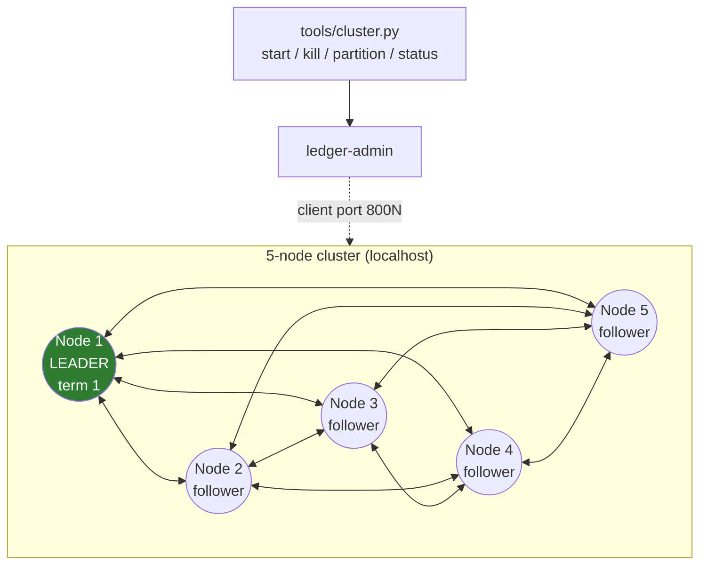

| Port | Used for |
|---|---|
| `700N` (peer port) | Hello handshake, Ping/Pong health probe, **Raft messages** |
| `800N` (client port) | Admin: `status`, `block`, `unblock`, `unblock-all`, `propose <text>` and `read` (test hooks) |

### 4.2 Inside one node

Everything runs on **one thread**: an epoll event loop. Raft is a **pure state machine** that never touches sockets or
files. The node feeds it inputs and carries out its outputs.

```
┌──────────────────────────── ledger-node (one thread) ───────────────────────────┐
│                                                                                 │
│   EventLoop (epoll + timerfd)                                                   │
│      │                                                                          │
│      ├── every 10ms ──▶ on_tick() ──▶ raft_.tick() ──────────┐                  │
│      │                         └──▶ peers_.tick() (redial)    │                  │
│      │                         └──▶ send Pings (every 50ms)   │                  │
│      │                                                        ▼                  │
│      ├── peer socket ──▶ PeerManager ──▶ Envelope            process_ready()     │
│      │                    + FaultFilter    ├─ raft ──▶ raft_.step() ─┐  1. persist│
│      │                                     ├─ ping ──▶ reply Pong    │  (memory) │
│      │                                     └─ pong ──▶ RTT/health    │  2. send  │
│      │                                                               │  3. apply │
│      │                                                               └──▶ (hash) │
│      └── client socket ─▶ admin: status / block / propose / read ─▶ propose()   │
│                                         (reads wait in pending_reads_) read_index()│
│                                                                                 │
│   RaftCore (pure: no I/O)          In-memory "disk" (until step 7)              │
│   role, term, votedFor, log,       hard_state_ {term, votedFor}, log_           │
│   commitIndex, Progress per peer   "state machine": applied_index_ + hash        │
└─────────────────────────────────────────────────────────────────────────────────┘
```

### 4.3 The Ready loop (the main design idea)

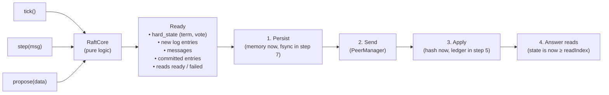

**Why persist before send:** a vote must be saved *before* the candidate hears about it. Otherwise a crash and restart
could let the node vote twice in one term, and two leaders could be elected.

### 4.4 Raft roles

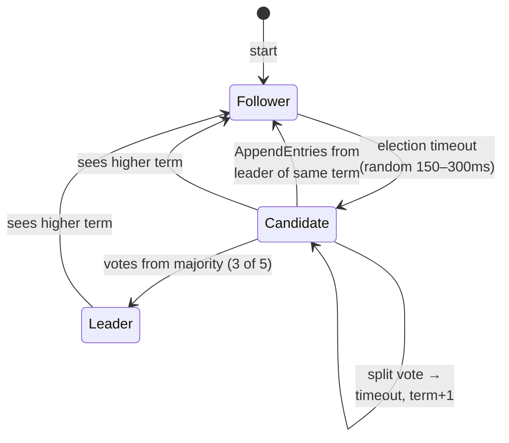

### 4.5 An election, message by message

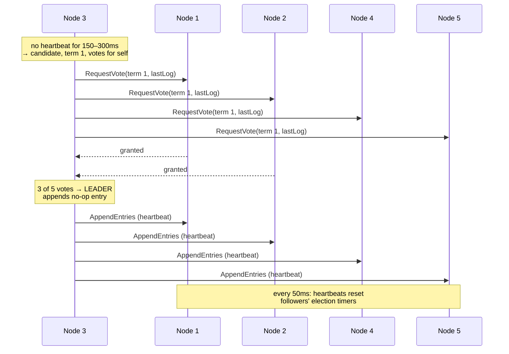

**A vote is granted only if:** the request's term is current, the voter hasn't voted for anyone else this term, **and** the
candidate's log is at least as up to date as the voter's (last term first, then length).

### 4.6 Replicating one entry

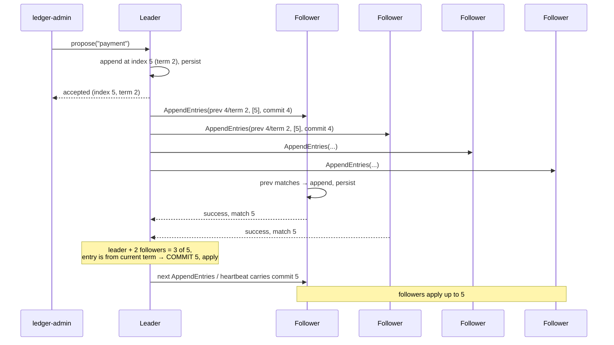

**The rules that make it safe:**
- **Consistency check:** a follower accepts entries only if it has the entry just before them (`prev index + term`).
  By induction, the whole log before that point then matches the leader (**Log Matching**).
- **Conflicts:** an entry with the same index but a different term is an uncommitted leftover from a deposed leader.
  The follower truncates from there and takes the leader's entries.
- **Fast backtracking:** a rejection includes a hint (`conflict_term`, `conflict_index`), so the leader skips a
  whole conflicting term in one round trip instead of going back one entry at a time.
- **Commit rule (Figure 8):** the leader commits index N only if a majority stores it **and** `log[N].term ==
  currentTerm`. An older-term entry on a majority can still be overwritten, so it is committed only indirectly,
  once a current-term entry after it commits. That's why a new leader appends a no-op.
- **Follower commit:** `min(leader_commit, last new entry)`, never past what this message verified.

### 4.7 How a divergent log is repaired

```
Before heal (old leader 1 was cut off and appended entries it could never commit):

  index:      1   2   3   4   5   6
  node 1:    [1] [1] [1] [1] [1]          ← term-1 entries 3-5: uncommitted leftovers
  node 3:    [1] [1] [2] [2] [2] [2]      ← new leader (term 2), 3-6 committed

1. AppendEntries(prev=6/term 2)  → node 1: "I have no index 6"    → reject, conflict_index = 6
2. AppendEntries(prev=5/term 2)  → node 1: "my 5 has term 1"      → reject, conflict_term = 1,
                                                                     conflict_index = 1 (start of its term-1 run)
3. Leader's last term-1 entry is index 2, so the logs must agree up to 2 → resend from 3
4. AppendEntries(prev=2/term 1, [3,4,5,6]) → matches → node 1 truncates its 3-5, appends 3-6 → identical
```

### 4.8 Linearizable reads (ReadIndex)

A leader can't just answer from its own state: it may have been deposed without knowing it, and then its data is stale.

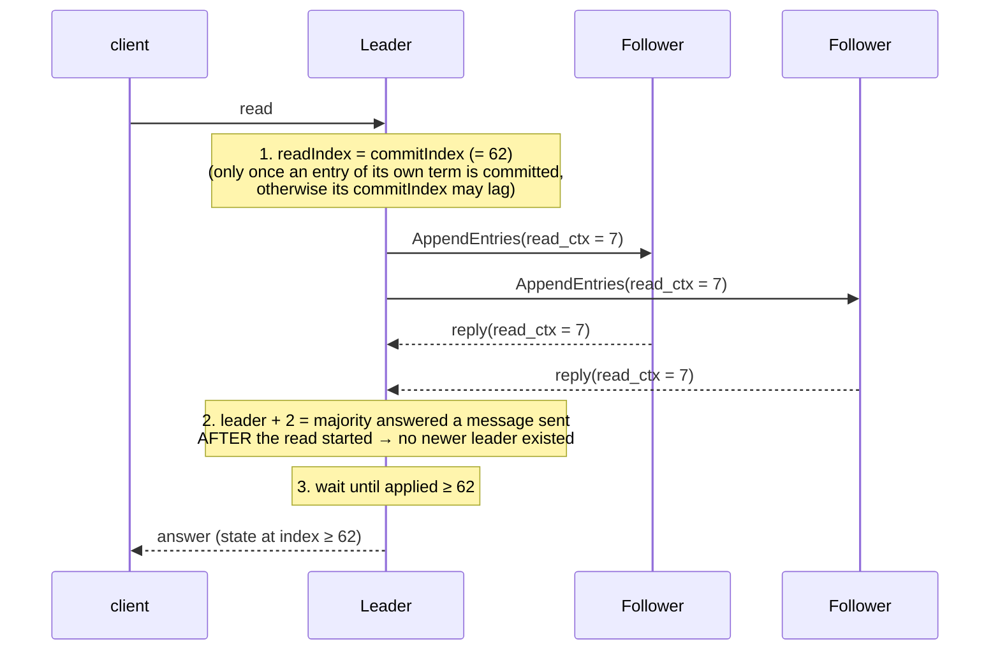

**Why each rule matters (each was tested by breaking it):**

| Rule | Without it |
|---|---|
| Confirm with a majority | A cut-off old leader answers with stale data |
| Count only replies to messages sent *after* the read started (`read_ctx`) | An old reply "confirms" leadership from before a new leader took over |
| New leader waits until its no-op commits | Its commit index may be behind writes the previous leader already committed |

A cut-off leader never gets the majority, so its reads hang. When it later sees a higher term it steps down and fails them, and the client retries on the new leader.

### 4.9 What happens on failures (verified by tests)

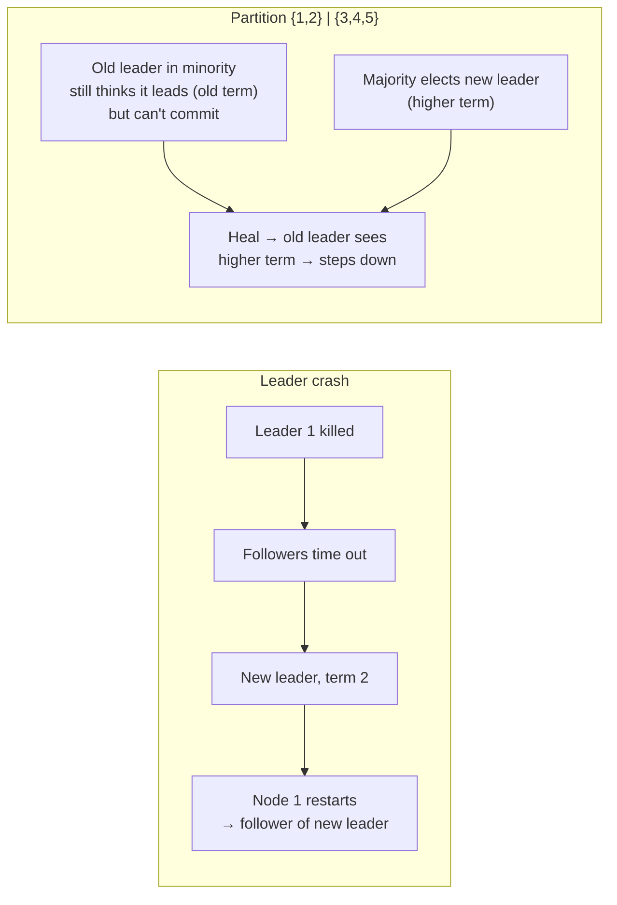

---

## 5. Tests

| Suite | Count | What it proves |
|---|---|---|
| `unit_tests` (network) | 26 | framing, connections, peer mesh, reconnect, fault filter, config |
| `unit_tests` (`RaftCore`) | 32 | votes, step-down, no-op, heartbeats; append/reject/truncate, conflict hints, backtracking, majority commit, **Figure 8**, follower commit bound; ReadIndex: majority ack, stale-reply ctx, new-leader wait, fail on step-down |
| `raft_sim_tests` | 13 | election (1000 seeds), crash, partition, loss/dup/reorder, split votes; **replication + commit**, crashed follower catches up, divergent log repaired, **all 5 safety properties under random crashes + partitions + proposals** (300 seeds); **stale leader never serves reads**; reads linearizable under random faults |
| `test_network.py` | 1 script | 5 real processes: mesh, kill/restart, partition/heal |
| `test_election.py` | 1 script | 5 real processes: election, failover, restart without disruption, partition, heal |
| `test_replication.py` | 1 script | 5 real processes: entries applied everywhere (same hash), follower catch-up, minority leader can't commit or answer reads, heal overwrites its entries |

```sh
cmake --build build -j && ctest --test-dir build      # 71 unit + sim tests (also pass under ASan/UBSan)
python3 tests/integration/test_network.py
python3 tests/integration/test_election.py
python3 tests/integration/test_replication.py
```

**Safety checks in the simulator** (run continuously, from Figure 3 of the Raft paper):

| Property | Meaning |
|---|---|
| Election Safety | at most one leader per term |
| Leader Append-Only | a leader never overwrites its own entries |
| Log Matching | same index + term ⇒ identical logs up to there |
| Leader Completeness | a new leader has every committed entry |
| State Machine Safety | no two nodes apply different entries at one index |
| Read Linearizability | a served read reflects every write committed before it started |

**Proof that the checks work (mutation testing):** each bug below was planted on purpose. The test that caught it is listed.

| Planted bug | Caught by |
|---|---|
| Allow voting twice in a term | sim: Election Safety |
| Skip the up-to-date log check when voting | sim: Leader Completeness |
| Skip the prev-entry consistency check | sim: State Machine Safety |
| Remove the Figure 8 current-term rule | unit: `Figure8OldTermEntryNotCommittedByCounting` (random sim missed it) |
| Follower commits past verified entries | unit: `FollowerCommitsOnlyUpToVerifiedEntries` (random sim missed it) |
| Truncate even when an entry already matches | unit: `StaleShorterAppendDoesNotTruncate` |
| Serve reads without a confirmation round | sim: Read Linearizability + unit tests |
| Don't wait for the new leader's no-op to commit | sim: Read Linearizability + unit test |
| Count replies to messages sent before the read | unit: `ReplyToMessageSentBeforeReadDoesNotConfirmIt` (random sim missed it) |

**Bugs found so far:**

| Bug | How found | Fix |
|---|---|---|
| Restarted node deposed a healthy leader (peers' reconnect backoff meant it heard no heartbeats) | `test_election.py` | Redial a peer as soon as it says Hello (+ unit test) |
| Restarted follower never caught up: it lost acknowledged entries (in-memory storage), but the leader never sent below its old `match` | `test_replication.py` | Leader resets `match` when a rejection is at or below it (+ unit test). The real fix is persistence (step 7) |
| `raft_` initialized from members declared after it (undefined behavior) | Code review | Pass empty state explicitly |
| Test called `tick()` on a "crashed" null PeerManager | Unit test crash | Fixed in the test |

---

## 6. What's left

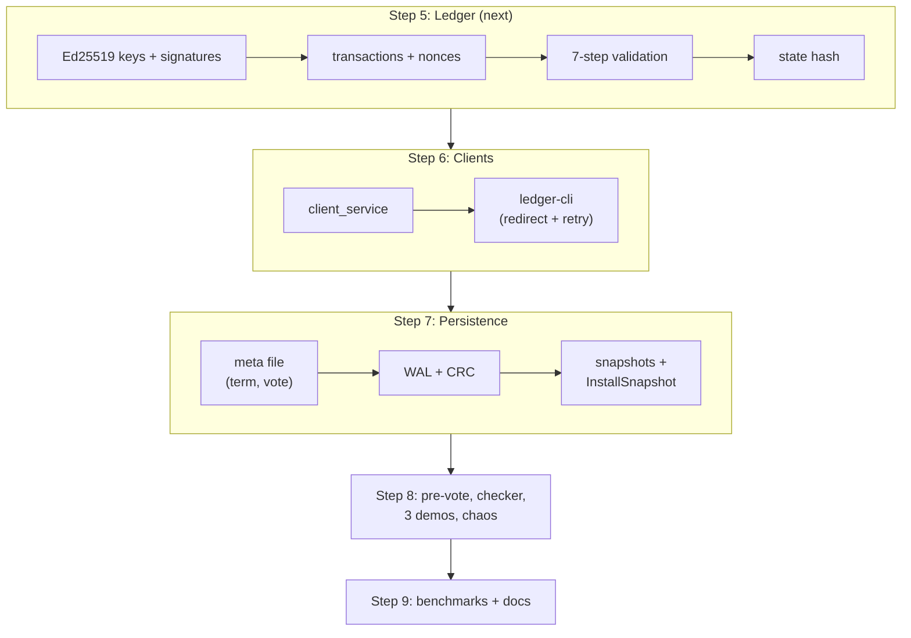

**Known gaps in the current code:**
- Storage is in memory, so a restarted node forgets its vote and its log (fixed in step 7).
- Proposals aren't tracked yet: the `propose` command answers "accepted", not "committed". Tracking + RETRY come with the client service (step 6).
- Each `apply` only updates a hash; the real ledger state machine comes in step 5.
- No pre-vote yet: a node that can't hear the leader can still disrupt it with a higher term (fixed in step 8).
- An old leader cut off in a minority doesn't step down by itself (harmless; check-quorum could fix it).
- `libsodium-dev` isn't installed yet (needed in step 5).
