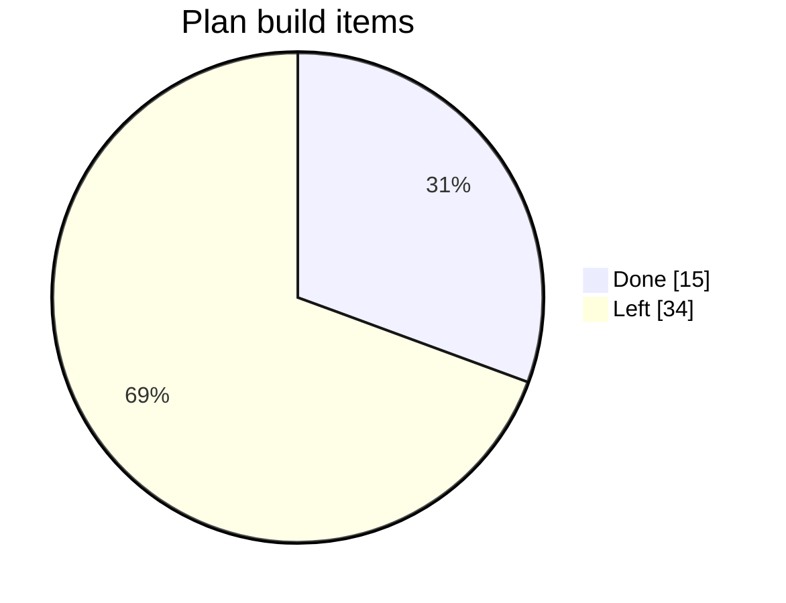
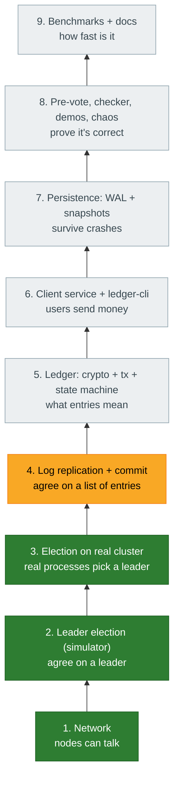
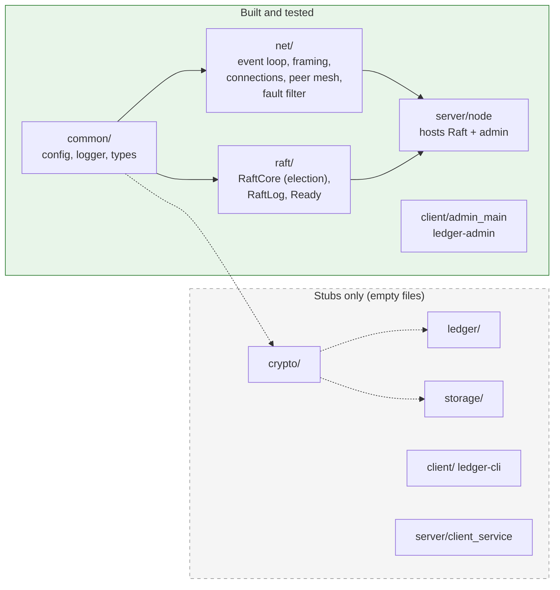
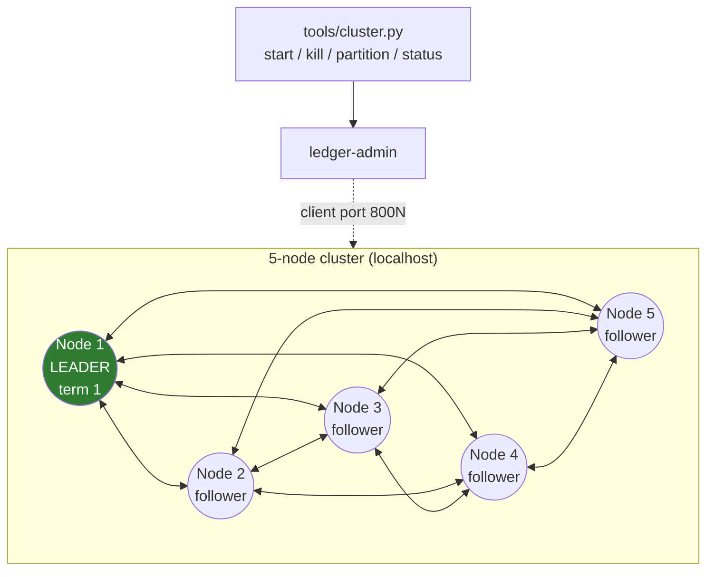
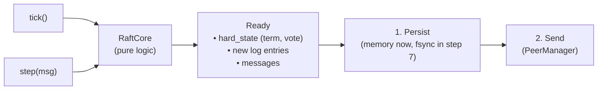
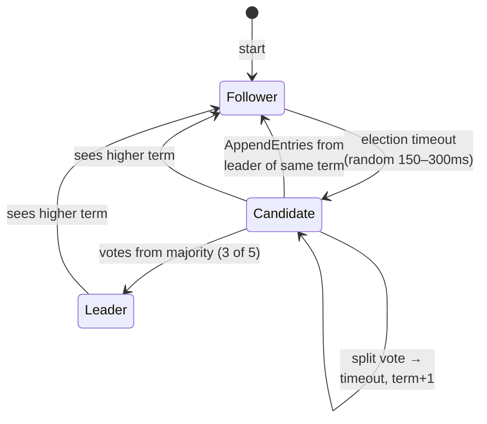
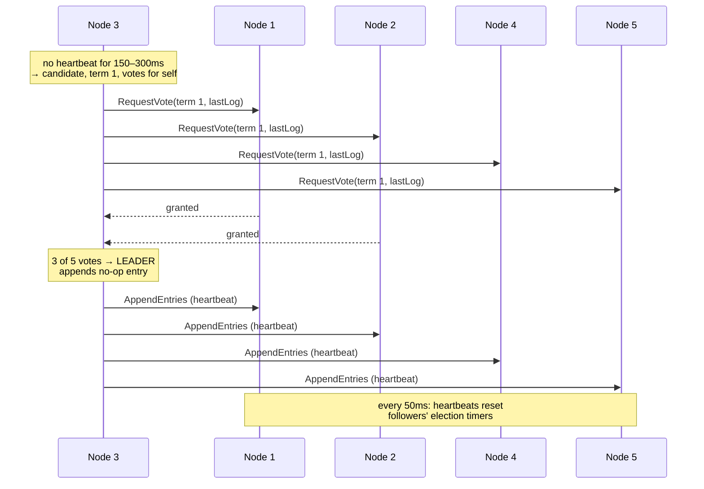
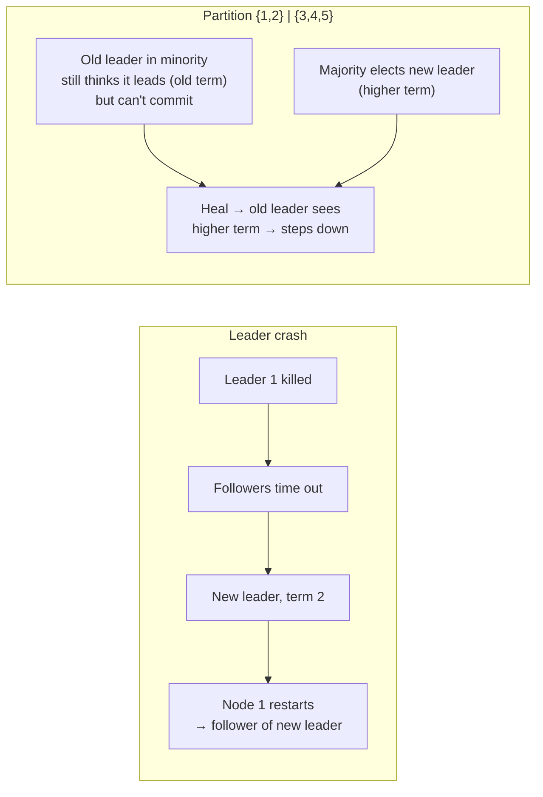
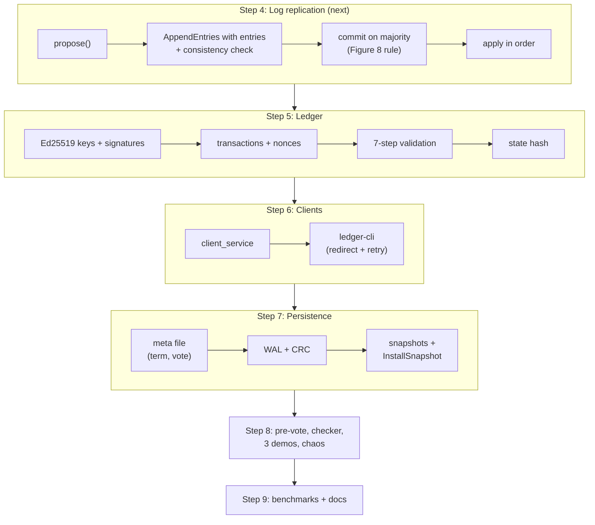

# QuorumPay: Progress

_Last updated: 2026-10-27_

This file shows **what is built, what is left, and how the working parts fit together today**.
The full design is in [`project_details.md`](project_details.md).

---

## 1. Overall progress

Counted against the **49 "Build" items** in the plan (§8 of `project_details.md`):

```
Overall   [██████████░░░░░░░░░░░░░░░░░░░░]  ~31%   (≈15 of 49 build items)
```



> By *effort* it's closer to **25%**, because the heaviest weeks (3, 5, 6) haven't started.

### By plan week

| Week | Topic | Progress | Status |
|---|---|---|---|
| 1 | Foundations: crypto, transactions, state machine | `██░░░░░░░░` 2 / 7 | 🟨 skeleton + framing only |
| 2 | Raft: leader election + simulator | `██████████` 6 / 6 | ✅ done |
| 3 | Raft: replication, commit, apply, ReadIndex | `░░░░░░░░░░` 0 / 7 | ⬜ next |
| 4 | Network + node + CLI | `███████░░░` 6.5 / 9 | 🟨 network + Raft-in-node done; client service + CLI left |
| 5 | Persistence: WAL, snapshots, recovery | `░░░░░░░░░░` 0 / 7 | ⬜ |
| 6 | Pre-vote, checker, demos, chaos | `░░░░░░░░░░` 0 / 6 | ⬜ |
| 7 | Benchmarks + docs | `█░░░░░░░░░` 0.5 / 7 | 🟨 README only |

---

## 2. Build order (bottom-up)

We build one layer at a time. Each step adds one idea and ends with something you can run.



| Step | Plan week | Status |
|---|---|---|
| 1. Network | Week 4 (items 1–4) | ✅ |
| 2. Election in simulator | Week 2 | ✅ |
| 3. Election on real cluster | Week 4 (item 5, partly) | ✅ |
| 4. Log replication + commit | Week 3 | 🔜 **next** |
| 5. Ledger (needs `libsodium-dev`) | Week 1 | ⬜ |
| 6. Client service + CLI | Week 4 (items 6, 8) | ⬜ |
| 7. Persistence | Week 5 | ⬜ |
| 8. Correctness under faults | Week 6 | ⬜ |
| 9. Benchmarks + docs | Week 7 | ⬜ |

---

## 3. Module status



| Module | Files | State |
|---|---|---|
| `common/` | `types.h`, `config`, `logger`, `clock.h` | ✅ (`status.h` is a stub) |
| `net/` | `event_loop`, `framing`, `connection`, `listener`, `peer_manager`, `fault_filter` | ✅ |
| `raft/` | `raft_core`, `raft_log`, `ready.h` | ✅ election only · `progress`, `read_index` are stubs |
| `server/` | `node`, `main` | ✅ runs Raft · `client_service`, `admin_service` are stubs |
| `client/` | `admin_main` (`ledger-admin`) | ✅ · `client_lib`, `keystore`, `ledger-cli` are stubs |
| `crypto/`, `ledger/`, `storage/` | — | ⬜ stubs |
| `proto/` | `peer`, `client`, `envelope`, `raft` | ✅ · `ledger.proto` is empty |

---

## 4. How it works today

### 4.1 The cluster

Five `ledger-node` processes on localhost form a **full mesh**. Each pair uses **two TCP connections**, one dialed in each
direction. `ledger-admin` and `tools/cluster.py` talk to each node's client port.



| Port | Used for |
|---|---|
| `700N` (peer port) | Hello handshake, Ping/Pong health probe, **Raft messages** |
| `800N` (client port) | Admin: `status`, `block`, `unblock`, `unblock-all` |

### 4.2 Inside one node

Everything runs on **one thread**: an epoll event loop. Raft is a **pure state machine** that never touches sockets or
files. The node feeds it inputs and carries out its outputs.

```
┌──────────────────────────── ledger-node (one thread) ───────────────────────────┐
│                                                                                 │
│   EventLoop (epoll + timerfd)                                                   │
│      │                                                                          │
│      ├── every 10ms ──▶ on_tick() ──▶ raft_.tick() ──────────┐                  │
│      │                         └──▶ peers_.tick() (redial)    │                  │
│      │                         └──▶ send Pings (every 50ms)   │                  │
│      │                                                        ▼                  │
│      ├── peer socket ──▶ PeerManager ──▶ Envelope            process_ready()     │
│      │                    + FaultFilter    ├─ raft ──▶ raft_.step() ─┐  1. persist│
│      │                                     ├─ ping ──▶ reply Pong    │  (memory) │
│      │                                     └─ pong ──▶ RTT/health    │  2. send  │
│      │                                                               └──▶ via    │
│      │                                                                 PeerManager│
│      └── client socket ─▶ admin: status / block / unblock                       │
│                                                                                 │
│   RaftCore (pure: no I/O)          In-memory "disk" (until step 7)              │
│   role, term, votedFor, log        hard_state_ {term, votedFor}, log_           │
└─────────────────────────────────────────────────────────────────────────────────┘
```

### 4.3 The Ready loop (the main design idea)



**Why persist before send:** a vote must be saved *before* the candidate hears about it. Otherwise a crash and restart
could let the node vote twice in one term, and two leaders could be elected.

### 4.4 Raft roles



### 4.5 An election, message by message



**A vote is granted only if:** the request's term is current, the voter hasn't voted for anyone else this term, **and** the
candidate's log is at least as up to date as the voter's (last term first, then length).

### 4.6 What happens on failures (verified by tests)



---

## 5. Tests

| Suite | Count | What it proves |
|---|---|---|
| `unit_tests` (network) | 26 | framing, connections, peer mesh, reconnect, fault filter, config |
| `unit_tests` (`RaftCore`) | 13 | vote rules, up-to-date log check, step-down, no-op, heartbeats |
| `raft_sim_tests` | 7 | one leader across **1000 seeds**; crash; partition; 25% loss + duplicates + reordering; split votes; safety under random crashes |
| `test_network.py` | 1 script | 5 real processes: mesh, kill/restart, partition/heal |
| `test_election.py` | 1 script | 5 real processes: election, failover, restart without disruption, partition, heal |

```sh
cmake --build build -j && ctest --test-dir build      # 46 unit + sim tests
python3 tests/integration/test_network.py
python3 tests/integration/test_election.py
```

**Bugs found so far:**

| Bug | How found | Fix |
|---|---|---|
| Restarted node deposed a healthy leader (peers' reconnect backoff meant it heard no heartbeats) | `test_election.py` | Redial a peer as soon as it says Hello (+ unit test) |
| `raft_` initialized from members declared after it (undefined behavior) | Code review | Pass empty state explicitly |
| Test called `tick()` on a "crashed" null PeerManager | Unit test crash | Fixed in the test |

---

## 6. What's left



**Known gaps in the current code:**
- Storage is in memory, so a restarted node forgets its vote (fixed in step 7).
- No pre-vote yet: a node that can't hear the leader can still disrupt it with a higher term (fixed in step 8).
- An old leader cut off in a minority doesn't step down by itself (harmless; check-quorum could fix it).
- `libsodium-dev` isn't installed yet (needed in step 5).
